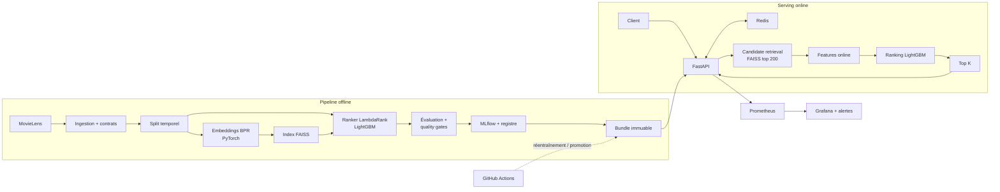

# Production Recommendation System

[](https://github.com/Juven14s/production-recommendation-system/actions/workflows/ci.yml)
[](https://github.com/Juven14s/production-recommendation-system/actions/workflows/docker.yml)
[](https://github.com/Juven14s/production-recommendation-system/actions/workflows/retrain.yml)

Moteur de recommandation de films en deux étapes, conçu comme une étude de cas
Machine Learning Engineering complète : données brutes, entraînement reproductible,
retrieval FAISS, ranking LightGBM, API faible latence, observabilité et promotion
contrôlée jusqu'en production.

> **Statut : production-ready V1.** Le champion `20261119T182524Z-150b09` a passé les
> quality gates, la validation d'intégrité, le smoke test Docker, puis les promotions
> `staging` et `production`.

## Résultats du champion

Mesures issues du premier [réentraînement GitHub Actions](https://github.com/Juven14s/production-recommendation-system/actions/runs/44587207119),
sur MovieLens 1M avec split temporel leave-two-out et seed `42`.

| Indicateur | Résultat | Rôle |
|---|---:|---|
| Recall@10 | **0,0767** | pertinence des 10 recommandations finales |
| NDCG@10 | **0,0365** | qualité de l'ordre des recommandations |
| Couverture catalogue@10 | **46,07 %** | diversité des films exposés |
| Candidate Recall@200 | **53,31 %** | efficacité de la génération FAISS |
| Latence retrieval p95 | **0,088 ms** | retrieval offline, hors réseau et ranking |
| Utilisateurs modélisés | **6 038** | utilisateurs avec historique exploitable |
| Films indexés | **3 525** | catalogue présent dans les interactions positives |

Les quatre gates de promotion sont passées :

| Gate | Seuil | Champion | État |
|---|---:|---:|:---:|
| Recall@10 | ≥ 0,070 | 0,0767 | ✅ |
| NDCG@10 | ≥ 0,035 | 0,0365 | ✅ |
| Couverture@10 | ≥ 40 % | 46,07 % | ✅ |
| Candidate Recall@200 | ≥ 50 % | 53,31 % | ✅ |

## Architecture



### Pourquoi deux étapes ?

1. **Candidate retrieval** réduit rapidement le catalogue à 200 films avec les
   embeddings BPR et un index FAISS inner-product.
2. **Ranking** calcule des features utilisateur/film et applique LightGBM LambdaRank
   pour ordonner finement les candidats.

Cette séparation permet d'augmenter le catalogue sans faire scorer chaque film par le
modèle le plus coûteux à chaque requête.

## Choix MLE importants

- **Évaluation temporelle** : les deux dernières interactions positives de chaque
  utilisateur sont réservées à la validation et au test.
- **Prévention des fuites** : le dataset du ranker est construit avec un retriever
  interne entraîné uniquement sur son historique autorisé.
- **Cold start** : un utilisateur inconnu reçoit un fallback de popularité déterministe.
- **Bundle autonome** : données de référence, embeddings, index, ranker, métriques,
  empreintes SHA-256 et manifeste sont versionnés ensemble.
- **Promotion fail-closed** : un bundle incomplet, altéré ou sous les seuils ne peut pas
  devenir champion.
- **Image d'inférence allégée** : PyTorch, CUDA et MLflow restent hors de l'image de
  serving ; les embeddings sont chargés depuis NumPy.
- **Rollback immuable** : `production` pointe vers une image `model-<version>` déjà
  construite et testée.

## Stack

| Domaine | Technologies |
|---|---|
| Data | Python, Pandas, PyArrow, SQL-ready Parquet |
| Modèles | PyTorch BPR, Item-KNN, LightGBM LambdaRank |
| Retrieval | FAISS |
| Serving | FastAPI, Redis, Uvicorn |
| MLOps | MLflow, GitHub Actions, GHCR, Docker |
| Observabilité | Prometheus, Grafana |
| Qualité | Pytest, Ruff, contrats de données, fingerprints SHA-256 |

## Démonstration locale

### 1. Installation

Prérequis : Python 3.11 ou 3.12, Docker Desktop et MovieLens 1M.

```powershell
git clone https://github.com/Juven14s/production-recommendation-system.git
cd production-recommendation-system
python -m venv .venv
.venv\Scripts\Activate.ps1
python -m pip install -e ".[dev]"
pytest
```

Télécharger [MovieLens 1M](https://files.grouplens.org/datasets/movielens/ml-1m.zip)
et extraire son contenu dans `data/raw/ml-1m`.

### 2. Reproduire le pipeline

```powershell
mle-ingest `
  --input-dir data/raw/ml-1m `
  --output-dir data/processed/ml-1m

mle-split `
  --ratings data/processed/ml-1m/ratings.parquet `
  --output-dir data/processed/ml-1m/splits

mle-retrain `
  --split-dir data/processed/ml-1m/splits `
  --movies data/processed/ml-1m/movies.parquet `
  --registry-root artifacts/model_registry `
  --tracking-uri sqlite:///artifacts/mlflow/mlflow.db
```

Le pipeline entraîne BPR, construit FAISS, entraîne LightGBM, journalise dans MLflow,
évalue les gates et promeut automatiquement le candidat s'il est conforme.

### 3. Lancer la plateforme

```powershell
docker compose up --build
```

| Service | URL locale |
|---|---|
| API Swagger | <http://localhost:8000/docs> |
| Health check | <http://localhost:8000/health> |
| Métriques brutes | <http://localhost:8000/metrics> |
| Prometheus | <http://localhost:9090> |
| Grafana | <http://localhost:3000> |
| MLflow | <http://localhost:5000> |

```powershell
Invoke-RestMethod http://localhost:8000/health
Invoke-RestMethod "http://localhost:8000/recommendations/1?k=10"
```

Exemple de réponse :

```json
{
  "user_id": 1,
  "k": 5,
  "model_version": "26498d83e704",
  "cold_start": false,
  "cached": false,
  "recommendations": [
    {
      "movie_id": 364,
      "title": "Lion King, The (1994)",
      "genres": "Animation|Children's|Musical",
      "score": 0.91,
      "rank": 1,
      "source": "faiss"
    }
  ]
}
```

Le score ci-dessus est illustratif ; les identifiants, titres et rangs proviennent du
smoke test local du bundle champion.

## CI/CD et gouvernance

| Workflow | Déclencheur | Responsabilité |
|---|---|---|
| `CI` | push sur `main` / pull request | Ruff, 24 tests, packaging, validation des configurations |
| `Container` | `main`, tags `v*` | build et publication de l'image de base dans GHCR |
| `Retrain` | manuel, lundi, tag `retrain-*` | dataset vérifié, entraînement, gates, artefacts |
| `Promote model image` | manuel, tag `promote-*` | validation, smoke test, staging/production |
| `Roll back model image` | manuel | restauration d'une image immuable connue |

Cycle de livraison appliqué à la V1 :

```text
retrain tag → quality gates → bundle versionné → staging → validation → production
                                                           ↘ rollback immuable
```

Runs de référence :

- [CI initiale réussie](https://github.com/Juven14s/production-recommendation-system/actions/runs/44534921405)
- [Réentraînement et création du champion](https://github.com/Juven14s/production-recommendation-system/actions/runs/44587207119)
- [Promotion staging](https://github.com/Juven14s/production-recommendation-system/actions/runs/44588331174)
- [Promotion production](https://github.com/Juven14s/production-recommendation-system/actions/runs/44589658763)

### Déclencheurs auditables

```powershell
git tag retrain-YYYY-MM-DD
git push origin retrain-YYYY-MM-DD

git tag promote-staging-<version>
git push origin promote-staging-<version>

git tag promote-production-<version>
git push origin promote-production-<version>
```

L'environnement GitHub `production` peut exiger une approbation avant que le job ne
reçoive l'autorisation de déplacer le tag d'image `production`.

## Observabilité

L'API expose notamment :

- latence HTTP et latence par étape retrieval/features/ranking ;
- taux de requêtes, exceptions et réponses vides ;
- hit/miss/error du cache Redis ;
- distribution des scores et nombre de candidats ;
- version active, taille du catalogue et fraîcheur des features.

Prometheus évalue des alertes de latence p95, taux d'erreur, absence de trafic et
fraîcheur. Grafana provisionne automatiquement le dashboard du service.

## Structure du dépôt

```text
.
├── .github/workflows/       # CI, retraining, promotion et rollback
├── configs/                 # hyperparamètres reproductibles
├── data/                    # données locales non versionnées
├── docs/                    # script de démonstration et préparation entretien
├── observability/           # Prometheus, alertes et dashboard Grafana
├── src/mle_recsys/
│   ├── api/                 # FastAPI, cache et métriques
│   ├── data/                # contrats, ingestion et split temporel
│   ├── mlops/               # MLflow, registry, gates et validation bundle
│   ├── models/              # popularité, Item-KNN et BPR
│   ├── ranking/             # features et LightGBM LambdaRank
│   └── retrieval/           # index et recherche FAISS
├── tests/                   # 24 tests unitaires et d'intégration légère
├── Dockerfile               # image complète entraînement/développement
├── Dockerfile.release       # image d'inférence sans stack d'entraînement
└── docker-compose.yml       # plateforme locale complète
```

## Limites et prolongements

Cette V1 démontre le passage de l'expérimentation au service observable. Pour une mise
à l'échelle réelle, les étapes suivantes seraient :

- test de charge distribué et SLO de latence end-to-end ;
- détection de dérive sur des interactions récentes ;
- A/B testing et métriques métier online ;
- feature store partagé online/offline ;
- stockage distant durable pour MLflow et les artefacts ;
- déploiement orchestré avec autoscaling.

## Ce que démontre ce projet

Le résultat n'est pas seulement un notebook de recommandation. Il démontre la capacité
à concevoir un système ML reproductible, testable, observable, déployable et réversible,
avec une séparation explicite entre entraînement, validation et serving.
